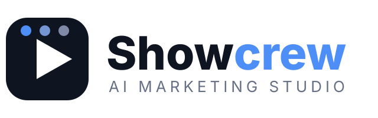

<p align="center"></p>

# Showcrew: AI Marketing Studio

**Your own marketing production house, inside your AI coding tool.** Brief the Marketing Manager; a crew of AI specialists
writes, directs, films, edits and checks the promo videos for you: app tutorials, ads, explainers, investor pitches and Shorts,
with natural voice-over in many languages. Works for any company, app, brand or creator.

Built to be fast and token-friendly, with the numbers to prove it (see [Measured](#measured)).

> **Credits.** Built on [coleam00/hyperframes-ai-video-generation](https://github.com/coleam00/hyperframes-ai-video-generation) by
> **Cole Medin**, powered by **[HyperFrames](https://hyperframes.heygen.com/)** (HeyGen). Terse mode is
> [caveman](https://github.com/JuliusBrussee/caveman), lean-code mode is [ponytail](https://github.com/DietrichGebert/ponytail).
> Full list in [`NOTICE.md`](NOTICE.md).

## See what it makes

<p align="center"><a href="docs/assets/showcrew-promo.mp4"></a><br>
<sub>A 20-second promo made with Showcrew itself: an AI-generated presenter (labelled as such), robot crew, voice-over and music. Click to watch the full video. Its recipe is <a href="examples/promo/workflow.json"><code>examples/promo/workflow.json</code></a>.</sub></p>

## Start in one minute

1. Paste this repo's link into your AI coding tool (for example Claude Code) and say **"set this up"**.
2. The AI runs `python3 showcrew setup`, then tells you, step by step, **which domains to allow**, **which keys to add as secrets**
   and exactly how. It never asks you to paste a key in chat.
3. Tell the Marketing Manager what you want to promote. It plans, you approve, the crew builds.

Doing it by hand: [`docs/SETUP-STEP-BY-STEP.md`](docs/SETUP-STEP-BY-STEP.md).

## The crew

| Role | Does | Skill |
|---|---|---|
| Marketing Manager | You brief it; plans the campaign, picks videos, keeps budget | `showcrew-manager` |
| Scripter | Video scripts: hook, scenes, narration, on-screen text, A/B hooks | `showcrew-scripter` |
| Director | Storyboards, shot lists, reference-video breakdowns, pacing | `showcrew-director` |
| Actors | Voices and on-screen presenters, with consent and AI disclosure | `showcrew-actors` |
| Cinematographer | Footage: free stock first, then free GPU, then rented GPU | `showcrew-cinematographer` |
| Editor | Builds the video, word-synced captions, tutorials from screen recordings | `showcrew-editor` |
| Sound designer | Pop-up sounds, generated music, correct levels | `showcrew-sound` |
| Brand guardian | Your colours, fonts, logo; privacy blurring | `showcrew-brand` |
| Producer | Frame and sync checks, one-page review, budget and token guard | `showcrew-producer` |
| Clone-video (opt-in) | Rebuilds a reference video's structure for you, optionally with Hypit | `showcrew-clone-video` |
| AI-marks (opt-in) | Removes AI provenance marks only if you ask, after a warning | `showcrew-ai-marks` |

`python3 showcrew crew` lists them.

## Features

- **One voice command** (`scripts/voice.py`): picks ElevenLabs, Gemini or offline Kokoro, whichever you have set up, applies your pronunciation list, and writes the same narration and word-timing files every time.
- Voice-over in any language: Gemini TTS (free tier), Kokoro (free, offline; `scripts/kokoro-onnx-tts.py` needs no PyTorch), Edge fallback, ElevenLabs (paid).
- Captions and highlights synced to every spoken word; no line cut off.
- **Workflow file** (`tools/workflow/`): describe a video once in JSON (text, cards, images, clips, sounds, music), anchored to spoken words. `check` validates and shows the timings, `build` writes the HyperFrames video and a report. Change the script and rebuild: everything moves with the words.
- **Lip-sync check** (`tools/lipsync/lipsync_check.py`): free, no model. Tells you when a voice line plays while the mouth is shut, and the audio-to-mouth delay.
- **Face enhance** (`tools/lipsync/face_enhance.py`): free, CPU-only sharpening of a face after lip-sync, which otherwise leaves the mouth soft.
- **Lip-sync maker** (`tools/lipsync/latentsync_job.sh`): re-times a face to a new voice line with LatentSync (Apache-2.0) on a rented or free GPU. Untested end to end; always checked afterwards with the lip-sync check.
- Tutorial builder: cuts waiting and typing from a screen recording, pop-out button cards, step titles.
- Privacy blurring of names, numbers, addresses and shop names.
- Screenshot editing: change text, price or product in app screenshots.
- Recreated UI (comments, notifications, live-stream screens) animated frame by frame.
- **Background music, made for you:** `tools/music/make_music.py` generates royalty-free tracks in code (calm corporate bed or funky groove), any length, ducked under the voice. No licence worries.
- Sound design: a soft sound on every pop-up (ding, chime, pop).
- AI footage: free (Wan 2.2 on Kaggle), or rented GPU with a hard time limit and a self-destruct timer.
- Reference-video breakdown: cuts, pacing and frame sheet, then 2-3 versions for your brand.
- **Word-anchored timing** (`tools/wordsync/`): place any on-screen item on a spoken word, not a second; a rewritten script can never leave it at a stale time.
- Reference cloning: free breakdown built in, plus an optional hand-off to [Hypit](https://github.com/hypit-ai/hypit) (installed by you, not bundled).
- Variants: many formats and hooks from one project.
- Quality gates: frame sheets, sync check, one-page review. Nothing renders without your approval.
- **Terse mode** (caveman) and **Lean mode** (ponytail) always on: short replies, small code.
- Free by default. Paid tools, uploads and rented GPUs only after you see the exact files, prompt and cost.
- Self-setup: `python3 showcrew doctor` checks tools, keys and domains and prints the fix.

## Commands

```
python3 showcrew setup | doctor | domains | secrets | crew
python3 showcrew new <slug> [--template classic]
python3 showcrew check <video.mp4> <sheet.png> <t1> [t2 ...]
python3 showcrew breakdown <file|URL> <out dir>
```

## Measured

| What | Before (old kit) | Now |
|---|---|---|
| Instructions the AI must read at start (`CLAUDE.md` + `AGENTS.md`) | 6,588 bytes (~1,650 tokens) | 3,201 bytes (~800 tokens), 51% less |
| Core command | none | one file, 139 lines, standard library only |
| Python packages `setup` installs | n/a | 3 (`numpy`, `pillow`, `python-dotenv`) |

Tokens are estimated as bytes / 4. Role guides load only when that role is called.

## Responsible use

Only use real people's faces or voices with their consent. Label AI-made people and clips where platforms or law require it.
Blur personal data. The AI-marks tool is opt-in and warns first.

## License: free to use, fair to share

Showcrew is **free for personal use, learning, testing and non-profit work**. Go ahead: try it, break it,
improve it, share it.

**Using it to make money?** That's great, and it's allowed. I just ask two things:
1. **Let me know** within 30 days: open an issue titled **"Commercial use"** in this repo, or reach me through my
   GitHub profile, [@rifatshahrukh-dev](https://github.com/rifatshahrukh-dev).
2. **Share 10% of the profit** it helps you make, once a year. If that doesn't fit your case, get in touch and we'll
   agree something fair.

That's what keeps this project alive and improving for everyone. "Making money" includes selling videos made with
it, offering it as a paid service, and using its videos to promote a business. The exact terms are in
[`LICENSE`](LICENSE).

The original project by **Cole Medin** stays under the **MIT License**, as he published it; the terms above cover
the Showcrew additions. Third-party tools and models keep their own licences.
